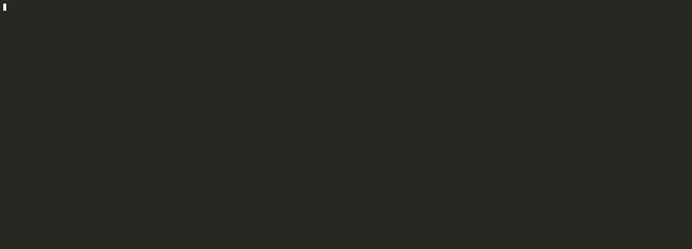

# ccautopsy

**On one developer machine, 24 % of all prompt-cache writes in 771 Claude Code sessions were rewrites of context that had already been cached. ccautopsy tells you why.**

Claude Code bills (and counts against your usage window) every token it sends. Prompt caching makes a cached prefix roughly 10× cheaper to *read* than to *write*, so a session that keeps hitting the cache is cheap and a session that keeps rebuilding it burns your quota. Token counters like ccusage tell you *how many* tokens you used. `ccautopsy` reads the same local transcripts and answers the next question: **which turns rebuilt the cache, and what caused each one.**



No network, no telemetry, no writes. It only reads `~/.claude/projects/**/*.jsonl`.

## Quickstart (30 seconds)

```sh
npx ccautopsy                 # all transcripts under ~/.claude/projects
npx ccautopsy --since 7d      # last week only
npx ccautopsy --session 428a  # turn-by-turn timeline, id prefix is enough
npx ccautopsy --json          # machine-readable
npx ccautopsy /some/dir       # another transcript directory or a single .jsonl file
```

Requires Node 20+. If [Bun](https://bun.sh) is installed, `npx ccautopsy` hands the run to Bun automatically (about 35% faster on large transcript sets). Set `CCAUTOPSY_NO_BUN=1` to stay on Node.

## Sample output

Real numbers from one machine, paths and ids replaced:

```
ccautopsy: 118 sessions, 11149 API calls

15.7M tokens were rewritten into the prompt cache in 223 rebuilds
  that is ~31% of all cache writes (51.0M), estimated extra cost ~$123.25 at API prices

Causes, ranked by tokens rewritten
  Prefix change (likely)          8.6M tokens    96 rebuilds    ~$67.40
    tip: Anything before the conversation (system prompt, tool list, CLAUDE.md, MCP servers, CLI version) invalidates the cache when it changes. ...
  TTL expiry                      3.2M tokens    23 rebuilds    ~$24.89
    tip: Breaks longer than the cache TTL rebuild the whole prompt. ...
  Compaction / context reset      2.5M tokens    73 rebuilds    ~$19.80
    tip: Compaction rewrites the prompt from scratch. ...
  History edit (likely)           1.1M tokens    25 rebuilds     ~$8.42
    tip: An earlier message was rewritten (old tool results cleared, attachments refreshed) ...
  Model switch                    352k tokens     3 rebuilds     ~$2.31
  Session resume or fork           65k tokens     3 rebuilds     ~$0.43

Worst sessions
  428ae318     4.7M tokens   40 rebuilds  mostly Prefix change (likely)  <project dir>
  91c920c4     2.7M tokens   24 rebuilds  mostly Prefix change (likely)  <project dir>
  cc23d178     1.8M tokens   17 rebuilds  mostly TTL expiry              <project dir>
```

A session timeline (`--session <id>`) marks the rebuilt turns in red:

```
  #    time      gap    model               prompt   write    read   share
    0  19:50:36      ?  claude-opus-5-5        74k     74k       0  100%
    1  19:50:54    18s  claude-opus-5-5        74k      4k     70k    5%
    2  19:51:36    43s  claude-opus-5-5        75k      5k     70k    6%
    3  19:51:57    21s  claude-opus-5-5        79k     79k       0  100%
       ^ Prefix change (likely) (low): 21 s after a cached turn, same model; system prompt, tools, CLAUDE.md or MCP servers likely changed; 75k tokens rewritten
    4  19:52:08    11s  claude-opus-5-5        80k      5k     75k    6%
```

Turn 0 is the first call of the session and is never counted: a cache has to be built once.

## What counts as a rebuild

Every assistant message in a transcript carries `usage.cache_creation_input_tokens` (written to cache), `usage.cache_read_input_tokens` (read from cache) and `usage.input_tokens` (neither). A turn is a **rebuild** when

- the prompt is at least 5,000 tokens, and
- at least 50 % of it was *written* rather than read.

The tokens "rewritten" are `min(cache_write, previous prompt size − tokens still read from cache)`. Genuine growth (you just read a big file) is never counted as waste. The first call of every session is skipped.

## How each cause is detected

Rules are applied in this order; the first match wins. Explicit evidence in the transcript beats inference from timing.

| Cause | Rule | Confidence |
|---|---|---|
| **Session resume or fork** | First call of a new session writes ≥ 20k tokens with no cache read, while another session in the same working directory made a call in the previous hour. | medium |
| **Compaction / context reset** | A `compact_boundary` system line or an `isCompactSummary` user line sits between this call and the previous one. | high |
| | No marker, but the prompt shrank to under 60 % of a previous prompt that was ≥ 50k tokens. | medium |
| **Model switch** | `message.model` differs from the previous call. Each model has its own cache. | high |
| **TTL expiry** | Gap since the previous call exceeds the cache TTL. The TTL is taken from the last turn that wrote to cache: 1 h if it used `cache_creation.ephemeral_1h_input_tokens`, else 5 min. | high |
| **Unknown** | Gap is over 5 min but inside a 1 h TTL. The cache should have survived; there is no evidence either way. | low |
| **Prefix change (likely)** | Same model, gap inside the TTL, Claude Code `version` changed between the two calls. | medium |
| **History edit (likely)** | Same model, gap inside the TTL, and ≥ 5k tokens were *still read* from cache: the system prompt and tools survived, so an earlier message changed. Claude Code does this when it clears old tool results or refreshes attachments. | medium |
| **Prefix change (likely)** | Same model, gap inside the TTL, nothing read from cache. Something before the conversation changed: system prompt, tool list, CLAUDE.md, MCP servers. | low |

Each cause comes with one tip in the report.

## Cost estimate

Costs are **estimates at pay-as-you-go API prices**. Per-model prices live in one table in `src/pricing.ts` (base input and cache-read from LiteLLM's price list, the same source ccusage uses; cache-write multipliers 1.25× for 5-minute and 2× for 1-hour from Anthropic's prompt-caching docs). The extra cost of a rebuild is `tokens × (write price − read price)`. Subscription plans do not publish a per-token quota, so for them treat the dollar figure as a relative measure, not a bill.

## Limits and false positives

Be honest with yourself about what this can and cannot see:

- **It infers, it does not know.** The API reports how many tokens hit the cache, not *why* they missed. "Likely" in a label means exactly that.
- **Prefix change is a residual bucket.** It is what remains after the explicit rules. On SDK-driven or heavily customised setups (changing system prompts per turn, dynamic tool lists) it will be large and the tool cannot tell you which part of the prefix changed.
- **Resume / fork detection is timing-based.** Claude Code does not link a resumed session to its parent, so a new session that merely starts in the same directory within an hour of another can be mislabelled.
- **`--since` cuts the report, not the analysis.** Detection runs on whole sessions so the first turn inside the window still sees its real predecessor; only rebuilds inside the window are counted.
- **Compaction without a marker** is detected from prompt shrinkage alone; a user who deletes a lot of context by other means looks the same.
- **Server-side evictions** inside the TTL are indistinguishable from prefix changes and land in "Unknown" or "Prefix change".
- **Long-running subagents** (`agent-*.jsonl`) are analysed as their own sessions. Their first call is skipped like any other.
- **Rebuilds are only counted when ≥ 50 % of the prompt was rewritten.** Partial rewrites below that are ignored, so totals are conservative.
- Prices change; the table is a snapshot. Unknown models fall back to Sonnet-class pricing.

## How it works

1. **parse** (`src/parse.ts`): walks the directory, reads each `.jsonl` line by line, keeps `assistant` lines with a `usage` object, merges the several lines that one API call produces by `requestId`, and notes compaction markers. One `Session` per file.
2. **detect** (`src/detect.ts`): walks each session's calls in order and flags rebuilds. Separately looks for new sessions that start big while a sibling in the same directory is warm (fork candidates).
3. **classify** (`src/classify.ts`): applies the rule table above to each flagged turn and attaches a cause, a confidence and a one-line detail.
4. **pricing** (`src/pricing.ts`): one small price table and the write-minus-read cost formula.
5. **report** (`src/report.ts`): aggregates by cause and by session, renders the terminal summary, the session timeline and the JSON document.
6. **cli** (`src/cli.ts`): argument parsing (`mri`), `--since`, `--session`, `--json`.

Tests use hand-written synthetic fixtures, one per cause, under `test/fixtures/`. No real transcript content is included.

## Development

```sh
bun install
bun run build      # bun build -> dist/cli.js (runs on Node >= 20)
bun test           # bun:test
node dist/cli.js test/fixtures
```

See `docs/demo.md` for recording the terminal demo.

## License

MIT © Elvinas Miltenis
